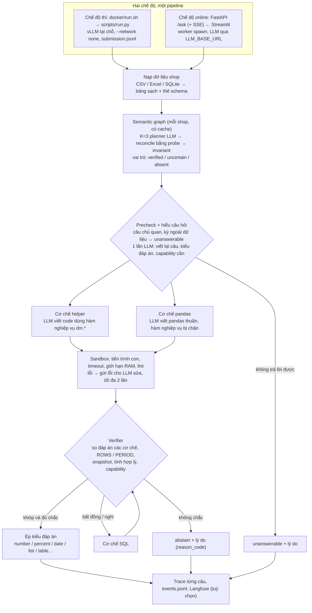

# DataMate Agent

Agent trả lời câu hỏi tiếng Việt về dữ liệu bảng của một cửa hàng nhỏ (CSV, Excel, SQLite). Đầu vào là thư mục
dữ liệu của shop, một câu hỏi và một ngày làm mốc (`as_of_date`). Đầu ra là một đáp án có kiểu (số, phần trăm,
chuỗi, ngày, đúng/sai, danh sách hoặc bảng), hoặc `unanswerable` / `abstain` khi câu hỏi không trả lời được hoặc
agent không chắc.

Agent chạy theo hai chế độ, dùng chung một pipeline:

- **Chế độ thi (offline)**: Docker có vLLM và weights đóng sẵn, chạy với `--network none`, đọc `/data` và ghi
  `/result/submission.jsonl`. Đây là bài nộp Zalo AI Challenge 2026.
- **Chế độ online (service)**: API FastAPI cộng UI Streamlit, gọi LLM qua `LLM_BASE_URL`, trả về đáp án kèm code đã chạy,
  các bước kiểm chứng và lý do khi bỏ câu.

## Agent làm gì

- **Đọc và chuẩn hoá dữ liệu.** Đọc mọi file của shop thành bảng sạch: dò header lệch dòng, gộp sheet và file theo
  tháng, điền ô gộp trong cùng đơn, bỏ dòng trùng, tách tiền, số lượng kèm đơn vị và ngày.
- **Hiểu cấu trúc dữ liệu.** Một planner LLM đề xuất vai trò của từng bảng và cột (bảng đơn, dòng hàng, trạng thái…).
  Đề xuất được kiểm lại bằng probe trên dữ liệu, rồi gắn nhãn *verified*, *uncertain* hoặc *absent*.
- **Viết code, không tự tính số.** LLM viết code pandas hoặc SQL dựa trên luật nghiệp vụ liên quan và các hàm
  có sẵn. Python chạy code trong sandbox có timeout và giới hạn bộ nhớ, rồi trả kết quả.
- **Kiểm chứng.** Mỗi câu được giải bằng hai cơ chế độc lập (hàm nghiệp vụ và pandas, cộng SQL khi hai cơ chế
  bất đồng). Verifier kiểm tra số dòng, kỳ thời gian và tính hợp lý. Nếu không khớp, agent bỏ câu.
- **Bỏ câu thay vì đoán.** Câu chủ quan, câu hỏi thông tin không có trong dữ liệu, hoặc câu mà agent không chắc
  sẽ trả `unanswerable` hoặc `abstain`.

## Kiến trúc



Mô tả từng thành phần: [`docs/architecture.md`](docs/architecture.md). Log và tracing:
[`docs/observability.md`](docs/observability.md).

## Kết quả

DeepSeek V4.1 Flash chạy trên tập dữ liệu của cuộc thi Zalo AI.

| Tập | Số câu | PA |
|---|---:|---:|
| Public test | 1000 | **0.915** |

PA (Penalized Accuracy) = (số câu đúng − số câu sai) / N. Câu bỏ (`abstain`) được 0 điểm.

## Quyết định thiết kế

**Python tính số, LLM không tính.** Câu hỏi về doanh thu, tỉ lệ hay xếp hạng cần đúng tuyệt đối: số tiền phải khớp
đến từng đồng, phần trăm phải khớp đến 2 chữ số thập phân. LLM đọc hiểu câu hỏi và cấu trúc dữ liệu tốt nhưng cộng
hàng trăm dòng thì không đáng tin. Vì vậy LLM chỉ viết code; con số do pandas hoặc SQLite tính trên dữ liệu thật.
Các luật nghiệp vụ hay gặp (đơn huỷ, đơn trả, đơn đang giao vẫn tính, làm tròn, kỳ "tuần trước", "tháng này", Tết)
được viết sẵn thành hàm `dm.*` có test, để code của LLM ngắn và ít chỗ sai. Hàm gắn với câu luật trong rulebook:
rulebook bỏ một luật thì hàm tương ứng tự tắt và LLM phải tự viết theo luật mới.

**Cross-check bằng cơ chế độc lập, không bằng cách hỏi lại.** Hỏi cùng một prompt ba lần thường cho ra cùng một lỗi.
Vì vậy mỗi câu được giải bằng hai cách khác nhau thật sự: một cách dùng hàm nghiệp vụ, một cách viết pandas thuần trên bảng
gốc (hàm nghiệp vụ bị chặn trong sandbox). Khi hai cách bất đồng thì chạy thêm cách thứ ba bằng SQL. Verifier còn
kiểm các kết quả trung gian: `ROWS` = 0 mà vẫn ra số, kỳ bắt đầu sau hôm nay, dùng cột chỉ đúng tại ngày cuối dữ liệu
khi hỏi về quá khứ, tên không có trong dữ liệu. Semantic graph cũng được kiểm theo cách đó: K planner đề xuất, probe
trên dữ liệu quyết định, và vai trò nào không chắc thì các câu cần đến nó bị bỏ.

**Bỏ câu khi không chắc.** Với PA, trả lời một câu có xác suất đúng *p* được kỳ vọng 2*p* − 1 điểm, còn bỏ câu được 0.
Chỉ nên trả lời khi *p* > 0,5. Đồng thuận giữa các cơ chế độc lập là tín hiệu để ước lượng *p*. Ngưỡng đồng thuận theo
nhóm câu (dùng hàm nghiệp vụ hay tự viết pandas) được chọn bằng cross-validation theo shop
(`scripts/tune_thresholds.py`). Câu chủ quan ("nhân viên nào lễ phép nhất") hay hỏi thông tin không có trong dữ liệu
trả `unanswerable` kèm lý do.

**Giới hạn đã biết** (có câu tương ứng trong eval synthetic):
- Hai cơ chế có thể cùng sai một kiểu, ví dụ cùng đếm cả đơn huỷ. Khi đó chúng khớp nhau và verifier để lọt.
- Verifier chưa so type đáp án với type mà bước hiểu câu hỏi đoán. Hai cơ chế cùng trả tỉ lệ dạng `0.1129` kiểu
  `number` thì vẫn qua, trong khi câu hỏi cần `percent` 11.29.

## Cài đặt

Yêu cầu: Python 3.12, [uv](https://docs.astral.sh/uv/), và một endpoint tương thích OpenAI.

```bash
uv sync                                         # pipeline + công cụ dev
uv sync --extra service --extra ui --extra obs  # thêm API, UI, Langfuse cho chế độ online
export LLM_BASE_URL=<endpoint tương thích OpenAI> LLM_MODEL=<tên model> LLM_API_KEY=<khoá>
```

Các biến khác đọc trong [`src/datamate/agent/llm.py`](src/datamate/agent/llm.py): `LLM_TIMEOUT`,
`LLM_MAX_TOKENS`, `LLM_EXTRA_BODY`.

## Chế độ thi (offline)

```bash
# chạy agent: ghi submission.jsonl dần dần, tiếp tục được nếu bị ngắt
uv run python scripts/run.py --split-dir path/to/data --out outputs/run01 --fill-missing

# kiểm tra format, rồi chấm nếu thư mục có answers.jsonl
uv run python scripts/check_submission.py outputs/run01/submission.jsonl --split path/to/data
uv run python scripts/score.py outputs/run01/submission.jsonl --split path/to/data
```

Ngoài `submission.jsonl`, mỗi lần chạy còn ghi `traces/<id>.json` (code, đáp án từng cơ chế, verifier) và
`events.jsonl` (một dòng mỗi câu: độ trễ, token, chi phí, reason_code).

Đóng gói Docker (chạy offline, weights đặt sẵn ở `./models/llm`, không có trong repo):

```bash
docker build -t datamate:latest --build-arg VLLM_IMAGE=vllm/vllm-openai:<tag> .
docker run --rm --gpus all --network none \
  -v <data>:/data:ro -v <out>:/result datamate:latest
```

Entrypoint bật vLLM, chạy agent trên `/data` và ghi `/result/submission.jsonl`. Giới hạn thời gian mặc định là
5,75 giờ (`TOTAL_HOURS`), tính cả thời gian load model. Câu chưa kịp giải được ghi `abstain`.

## Chế độ online (service)

```bash
cp .env.example .env          # điền LLM_BASE_URL, LLM_MODEL, LLM_API_KEY
docker compose up --build     # UI: http://localhost:8501   API: http://localhost:8000/docs
```

Không dùng Docker: `make serve` (API, cổng 8000) và `make ui` (Streamlit, cổng 8501). Image online
(`docker/service.Dockerfile`) tách hẳn khỏi `Dockerfile` thi: không có vLLM, không có weights.

```bash
# thư mục shop nằm trong DATAMATE_DATA_ROOT (compose: ./data mount vào /data)
curl -s localhost:8000/ask -H 'content-type: application/json' \
  -d '{"data_dir": "shop_a", "question": "Doanh thu tháng 2/2026 là bao nhiêu?"}'

# tải file lên, nhận từng bước qua Server-Sent Events
curl -N localhost:8000/ask/upload -F files=@BanHang.xlsx -F files=@README.md \
  -F question='Top 3 mặt hàng bán chạy quý 1/2026?' -F stream=true
```

Kết quả gồm `answer`, `type`, `code` (code của cơ chế cho đáp án), `mechanisms` (đáp án và code từng cơ chế),
`verifier`, `reason_code`, `abstain_reason` / `unanswerable_reason` và `usage` (token, chi phí). Stream trả lần lượt các
event `load`, `graph`, `precheck`, `understand`, `mechanism`, `verifier`, `result`. Không truyền `as_of_date` thì mốc
"hôm nay" là ngày cuối dữ liệu. Rulebook mặc định là bản tự viết trong
[`src/datamate/service/default_rulebook.md`](src/datamate/service/default_rulebook.md); đặt `DATAMATE_RULEBOOK`,
`DATAMATE_CALENDAR` để dùng bản khác.

## Eval và kiểm thử

```bash
make test         # pytest: shop tổng hợp sinh ngẫu nhiên + LLM giả
make eval-synth   # scripts/run.py trên split synthetic với LLM giả HTTP: mỗi câu phải ra đúng kết quả kỳ vọng
make smoke        # chạy entrypoint thi docker/run.sh với LLM giả (không vLLM), kiểm format file nộp
make check        # lint + 3 lệnh trên (CI chạy đúng các bước này)
```

Split synthetic ([`tests/synth_split.py`](tests/synth_split.py)) gồm 2 shop khác nhau về tên cột, nhãn trạng thái,
bố cục và định dạng file. Đáp án được tính độc lập bằng pandas. Kịch bản LLM giả cho cơ chế helper viết code `dm.*`
thật, còn có câu được cài lỗi có chủ đích: cơ chế pandas sai, ba cơ chế bất đồng, hai cơ chế cùng sai, code lỗi, trả sai
type. Đổi logic verifier hay reconcile mà làm lệch kết quả của bất kỳ câu nào thì CI fail.

Trên dữ liệu thật (chạy local, dữ liệu không có trong repo):

```bash
export DATAMATE_DEV_SPLIT=/path/to/labeled_split
make eval                                  # N câu đầu mỗi shop (PER_SHOP=5): PA tổng, theo type, theo reason_code
make report RUN=outputs/eval/<timestamp>   # báo cáo lỗi theo nhóm nguyên nhân (markdown)
```

`make eval` ghi `eval/results/<timestamp>.json` (chỉ có id, điểm, cấu hình; không có câu hỏi hay đáp án) và so với lần
đạt gần nhất của cùng split. PA tổng giảm quá 0,01, hoặc PA một type (≥ 10 câu) giảm quá 0,05, thì fail. Xem
[`eval/README.md`](eval/README.md). Báo cáo lỗi xếp mỗi câu không đúng vào một nhóm: đọc dữ liệu, hiểu sai câu hỏi,
codegen lỗi, verifier để lọt, abstain sai.

## Định dạng

Thư mục dữ liệu đầu vào:

```
<data>/
├── questions.jsonl          {"id", "business_id", "question", "as_of_date"}
├── answers.jsonl            tuỳ chọn, chỉ có khi có nhãn: {"id", "type", "answer", "alias"}
├── rulebook.md              luật nghiệp vụ mặc định
├── calendar.csv             lịch âm–dương, ngày lễ
└── data/<business_id>/      README.md và các file .csv / .xlsx / .sqlite của shop
```

Đầu ra, mỗi dòng `{"id", "type", "answer"}`. `type` là một trong: `number`, `percent`, `string`, `date`,
`boolean`, `list`, `table`, `unanswerable`, `abstain`. Số là JSON number không kèm đơn vị. Phần trăm ghi
`12.4`, không ghi `0.124`.

## Cấu trúc

```
src/datamate/
├── loaders/        đọc file, parse tiền, số, ngày; thẻ schema
├── agent/          planner, reconcile, invariant, luật, sinh code, sandbox, verifier
├── service/        engine, worker, API FastAPI, UI Streamlit, rulebook mặc định (chế độ online)
├── biz.py          hàm nghiệp vụ dùng trong code do LLM viết (`dm`)
├── rules.py        neo luật, thông số đọc từ rulebook
├── answer.py       ép kiểu đáp án
├── scoring.py      chấm PA
├── obs.py          đo LLM, sự kiện JSON mỗi câu, Langfuse
└── analysis.py     phân nhóm nguyên nhân lỗi
scripts/            run.py, eval.py, error_report.py, events_to_csv.py, score.py, check_submission.py,
                    smoke_entrypoint.sh, tune_thresholds.py, count_params.py
tests/              test, split synthetic, LLM giả (trong tiến trình và HTTP)
Dockerfile, docker/run.sh                  chế độ thi
docker-compose.yml, docker/service.Dockerfile   chế độ online
```

## Giấy phép

MIT. Xem [LICENSE](LICENSE).
