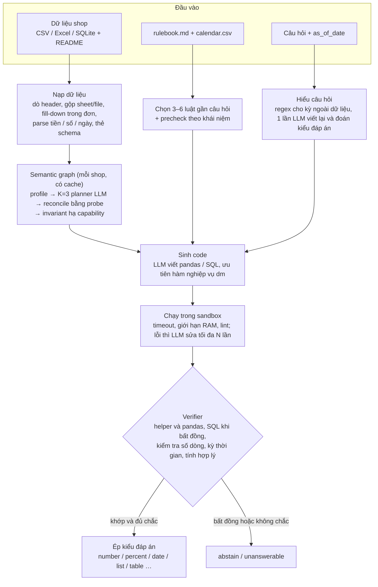

# Kiến trúc DataMate Agent

Agent trả lời câu hỏi tiếng Việt trên dữ liệu bảng của một shop nhỏ. LLM viết code, Python tính ra số.
Mỗi câu được giải bằng hai cơ chế độc lập, và agent bỏ câu khi hai cơ chế không khớp hoặc khi không chắc.

Giải pháp cho Zalo AI Challenge 2026.

## Sơ đồ

## Các thành phần

- **Nạp dữ liệu** (`src/datamate/loaders/`): đọc mọi file của shop thành DataFrame sạch và sinh thẻ schema.
- **Semantic graph** (`src/datamate/agent/semantic_*.py`, `invariants.py`): gắn vai trò cho bảng và cột, mỗi vai trò là
  *verified*, *uncertain* hoặc *absent*. Graph được tính một lần cho mỗi shop.
- **Luật** (`rules.py`, `precheck.py`): đưa luật liên quan vào prompt. Câu chủ quan hoặc hỏi thông tin không có
  trong dữ liệu trả `unanswerable` ngay.
- **Sinh và chạy code** (`agent/solver.py`, `prompts.py`, `sandbox.py`, `lint.py`): code chạy trong tiến trình con có
  timeout và giới hạn bộ nhớ.
- **Hàm nghiệp vụ** (`biz.py`): thư viện `dm` cho code do LLM viết, ví dụ `dm.orders()`, `dm.sold_lines()`.
- **Verifier** (`agent/verifier.py`): so kết quả của các cơ chế, kiểm tra và quyết định trả đáp án hay bỏ câu.
- **Ép kiểu** (`answer.py`): đưa đáp án về đúng kiểu và định dạng đầu ra.
